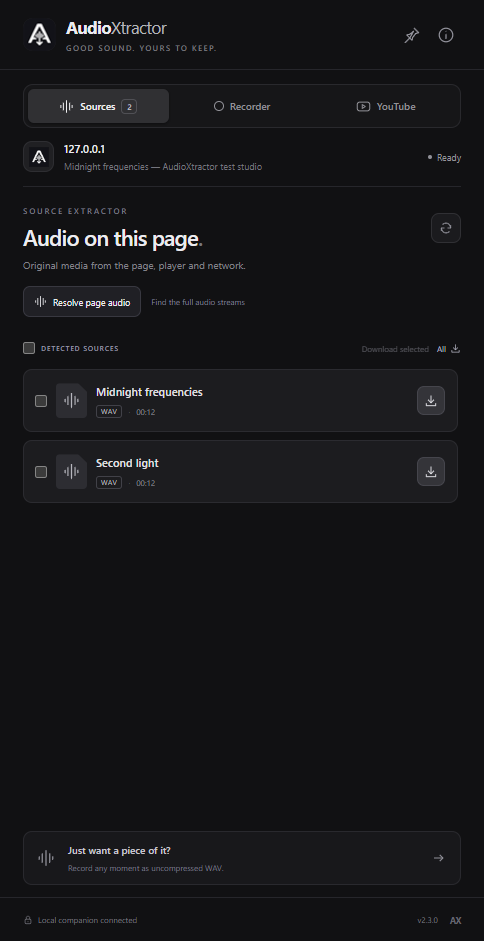
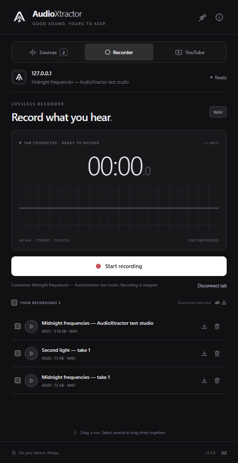

<div align="center">
  
  <h1>AudioXtractor</h1>
  <p><strong>Good sound. Yours to keep.</strong></p>
  <p>Find original audio, record a moment, and bring it straight into your workflow.<br>A minimal black and charcoal extension for Chrome, Brave, and Edge.</p>
  <p><a href="https://github.com/jordanw0204-rgb/AudioXtractor/releases/latest"><strong>Download the latest release</strong></a> &nbsp; · &nbsp; <a href="docs/INSTALLATION.md">Installation guide</a> &nbsp; · &nbsp; <a href="docs/PRIVACY.md">Privacy</a></p>
</div>

## Get started

1. Download **AudioXtractor-2.3.0.zip** from [Releases](https://github.com/jordanw0204-rgb/AudioXtractor/releases/latest). This is the ready-to-load extension; no build or package installation is needed.
2. Extract the ZIP to a permanent folder, such as `AudioXtractor`. Keep the extracted files together.
3. Open your browser's extensions page: `chrome://extensions`, `brave://extensions`, or `edge://extensions`.
4. Turn on **Developer mode**, choose **Load unpacked**, and select the extracted folder containing `manifest.json`.
5. Open a website, then click AudioXtractor in the extensions menu. Pin its toolbar icon for quick access.

**That's enough for source downloads and WAV recording.** Native file dragging, always-on-top pinning, stream resolution, and YouTube conversion use the optional [Windows companion](docs/INSTALLATION.md#windows-companion). Download its separate ZIP only if you want those features.

Choose the named **AudioXtractor-2.3.0.zip** release asset. GitHub's automatic “Source code” archives contain the development project.

## A look inside

<div align="center">
  
  
  <p><sub>The actual extension in a local test session. Screenshots use demo media; no personal recordings are shown.</sub></p>
</div>

## What it does

| | |
| --- | --- |
| **Original sources** | Discover audio from page players, links, metadata, and network responses. Download original files individually or in batches. |
| **Uncompressed recording** | Record the current tab to 32-bit float WAV, with a live waveform, pause/resume, and a local recording library. No microphone or Share picker. |
| **A window that stays with you** | Resize the panel; its dimensions and position are remembered. Pin it above other apps with the Windows companion. |
| **Drag into your workflow** | With the companion, drag a saved recording or completed conversion into Desktop, a folder, or an app that accepts audio files. Select several to drag together. |
| **YouTube → MP3** | Convert the current video or paste multiple video links. Local 320 kbps MP3 conversion, batch selection, downloads, and native dragging use the companion. |
| **Local by design** | No AudioXtractor account, analytics, ads, or conversion server. Audio processing and the recording library stay on your device. |

## Recording and sound quality

Open **Recorder** and wait for the tab to connect. The waveform monitors audio, but nothing is saved until you click **Start recording**. **Stop & save recording** saves the take and keeps the input ready for the next one. Disconnect, leave Recorder while idle, or close the idle panel to release capture. Active recordings continue with the panel closed; stop and save before closing the browser.

Direct downloads preserve the original resource bytes. WAV recordings save the Float32 samples delivered by the browser without lossy encoding, normalization, EQ, or dithering. Chrome can mix or resample before capture, so recorded PCM is not guaranteed to match the original source bit for bit. MP3 conversion is lossy.

Chrome can briefly interrupt playback when a tab first connects. Subsequent Record/Stop actions reuse the same connection. Opening Recorder before starting website playback avoids that transition during a take.

Each WAV is limited to 2 GB and available local storage. Stereo 48 kHz Float32 uses about 23 MB per minute. Export recordings before uninstalling the extension or clearing its storage. Protected players, private media, and expired URLs may prevent extraction or capture.

## Compatibility

- **Extension:** desktop Chrome, Brave, or Edge based on Chromium 116 or newer. Load unpacked using Developer mode. This release is distributed through GitHub, not a browser store.
- **Optional companion:** Windows, .NET 9 Desktop Runtime, Node.js 22+, FFmpeg, and a current yt-dlp installation. [Setup and troubleshooting →](docs/INSTALLATION.md)
- **Updates:** keep the same extension folder path and replace its contents, then click **Reload** on the extensions page. Save active recordings first. Keeping the path preserves the unpacked extension ID and its library.

## Development

Use Node.js 22 or newer. The extension has no npm dependencies; `npm install` is not required.

```sh
npm test
npm run check
npm run build
```

The build writes `dist/AudioXtractor/` and `dist/AudioXtractor-2.3.0.zip`. Load the folder in your browser or extract the ZIP. On Windows, building and registering the companion requires the existing .NET 9 SDK and tools listed in the installation guide:

```sh
npm run setup:companion -- --extension-id YOUR_EXTENSION_ID
npm run build
```

The second build also packages the companion. Generated `tools.json`, native-host registration, browser profiles, recordings, and local tool binaries are excluded from Git and from portable release archives.

### Tests and previews

`npm run test:browser` uses an existing Playwright installation and Chromium browser. It stays muted and never starts reference audio. To use an existing `playwright` or `playwright-core` package, set `AUDIOXTRACTOR_PLAYWRIGHT_PATH` to its package directory. `AUDIOXTRACTOR_BROWSER_EXE` selects an installed Chromium browser; `HEADED=1` enables a visible test window.

`npm run test:native` checks the installed Windows companion and performs a small YouTube conversion without playback. The separate `test:audio` suite plays reference audio and requires explicit opt-in with `AUDIOXTRACTOR_AUDIBLE_TESTS=1`.

`npm run dev` serves a local test studio and an inactive interface preview. `npm run launch` opens the built extension in a separate development browser profile.

### Project layout

| Path | Purpose |
| --- | --- |
| `extension/` | Manifest V3 extension, panel, source discovery, audio engine, and local library |
| `native/` | Windows native messaging companion, file dragging, and installer |
| `scripts/` | Dependency-free checks, icons, ZIP packaging, and development tools |
| `tests/` | Unit checks and browser/native integration checks |
| `docs/` | Installation, privacy, icon design, and real app screenshots |

The setup guide follows [Chrome's unpacked-extension instructions](https://developer.chrome.com/docs/extensions/get-started/tutorial/hello-world#load-unpacked). See [privacy and permissions](docs/PRIVACY.md) for how website access, tab capture, storage, and native messaging are used.
